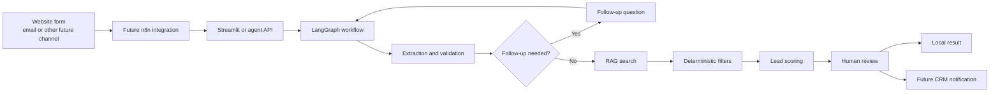
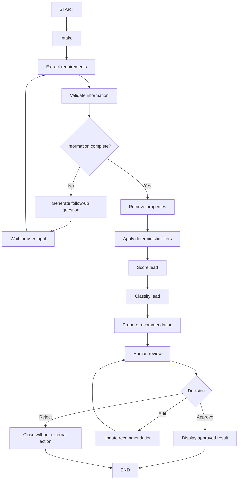

# Chleo Lite Architecture

## 1. Architecture Overview

Chleo Lite is a local MVP for qualifying fictional real estate leads in Mallorca. The demo focuses on one lead at a time and keeps a human reviewer in control. The architecture combines Streamlit, Pydantic, LangGraph, LangChain, OpenAI embeddings, Chroma, and a deterministic Python scoring function.

This document separates the local MVP from future business integrations. The MVP covers lead intake, extraction, validation, retrieval, scoring, and human review. Future n8n and CRM connections are planned only as next steps.

## 2. MVP Components

| Component | Technology | Responsibility | Input | Output | MVP or future |
|---|---|---|---|---|---|
| Streamlit interface | Streamlit | Collect a fictional inquiry and display the result | Lead text and follow-up answers | Structured local result | MVP |
| Pydantic validation | Pydantic | Validate input and agent state fields | Raw inquiry and structured data | Validated model objects | MVP |
| LangGraph workflow | LangGraph | Orchestrate the step-by-step agent flow | Validated state | Routed workflow state | MVP |
| OpenAI chat model | OpenAI chat model | Extract requirements and draft follow-up questions | Inquiry text and state context | Structured extraction and question text | MVP |
| LangChain retrieval | LangChain | Build retrieval documents and query the property corpus | Property text and metadata | Candidate property set | MVP |
| Chroma | Chroma | Store and retrieve embedded property documents locally | Documents and embeddings | Ranked semantic matches | MVP |
| Deterministic filters | Python rules | Enforce exact business constraints | Candidate properties and lead requirements | Filtered property list | MVP |
| Lead-scoring function | Python rules | Score lead readiness from 0 to 100 | Extracted requirements and consent data | Score and classification | MVP |
| Human-review checkpoint | Manual step | Review, edit, approve, or reject the recommendation | Recommendation and score | Human decision | MVP |
| n8n orchestration | n8n | Handle future triggers, routing, and notifications | Webhooks or form events | External workflow actions | Future |
| Future CRM or lead store | CRM / database | Store approved leads and follow-up status | Approved structured lead data | Persistent sales record | Future |

## 3. End-to-End Data Flow

1. A user enters a fictional buyer inquiry in Streamlit.
2. The inquiry is validated.
3. LangGraph creates the initial agent state.
4. The extraction node identifies budget, preferred location, property type, purchase timeline, financing status, and consent to contact.
5. The validation node checks which required fields are missing.
6. If information is missing, the graph generates one relevant follow-up question.
7. The user provides the missing information and the workflow continues.
8. When enough information is available, the retrieval node searches the fictional property catalogue.
9. Exact constraints such as budget and availability are checked with deterministic filters.
10. Semantic retrieval supports matching descriptions, locations, and desired features.
11. The scoring function calculates an explainable score from 0 to 100.
12. The lead is classified as hot, warm, or cold.
13. The system prepares a structured recommendation.
14. The workflow pauses for human review.
15. The human can approve, edit, or reject the recommendation.
16. The MVP displays the result locally.
17. No real customer message is sent.

## 4. LangGraph Workflow

LangGraph is used because the process has clear decision points. The workflow can move forward, loop back for more information, or stop for review without hiding the state changes.

## 5. Agent State

The agent state is the shared object that LangGraph passes between nodes. It keeps the process transparent and makes testing easier.

| Field | Type or structure | Purpose | Node that updates it |
|---|---|---|---|
| `inquiry_text` | String | Stores the current buyer message | Intake node |
| `conversation_history` | List of messages | Keeps the short local dialogue context | Intake and follow-up nodes |
| `extracted_requirements` | Dictionary or Pydantic model | Holds the six required lead fields | Extraction node |
| `missing_fields` | List of strings | Tracks which required fields are still missing | Validation node |
| `follow_up_question` | String | Stores one relevant follow-up question | Question generation node |
| `candidate_properties` | List of property records | Stores semantically relevant property matches | Retrieval node |
| `filtered_properties` | List of property records | Keeps only properties that pass exact filters | Filter node |
| `lead_score` | Integer from 0 to 100 | Stores the deterministic lead score | Scoring node |
| `lead_classification` | String | Stores hot, warm, or cold | Classification node |
| `confidence` | Float or text label | Records model or workflow confidence | Extraction and review nodes |
| `recommendation` | Dictionary or structured text | Holds the final structured recommendation | Recommendation node |
| `human_decision` | String | Stores approve, edit, reject, or request more info | Human-review node |
| `errors` | List of error strings | Collects runtime issues for fallback handling | Validation and error nodes |
| `status` | String | Tracks the current workflow stage | All workflow nodes |

## 6. RAG Pipeline

The RAG pipeline works on a small fictional property catalogue stored in `data/sample_properties.json`.

1. Load fictional properties from `data/sample_properties.json`.
2. Validate the property records.
3. Convert each property into a LangChain document.
4. Keep structured attributes as metadata.
5. Create embeddings.
6. Store them in local Chroma.
7. Retrieve semantically relevant candidates.
8. Apply exact filters for active status, maximum budget, property type, and required bedrooms when specified.
9. Rank the remaining matches.
10. Return a small set of candidates with their source property IDs.

Semantic similarity is useful for descriptions, location language, and feature matching. It must not be used alone for exact constraints such as price, availability, or required bedrooms. Those rules need deterministic checks so the system does not suggest a property that is over budget or unavailable.

## 7. Lead-Scoring Component

The score uses a transparent 100-point model:

- Budget and stock compatibility: up to 25 points
- Purchase timeline: up to 25 points
- Financing readiness: up to 20 points
- Location and property-type clarity: up to 20 points
- Consent and contact readiness: up to 10 points

Classification:
- Hot: 75-100
- Warm: 45-74
- Cold: 0-44

The score is calculated by deterministic Python rules. The LLM helps extract and explain the input, but it does not directly choose the final numerical score. Protected characteristics are never used. A low score does not reject the person automatically. The score only supports sales prioritisation.

## 8. Human Approval Points

Human approval is required before:

- Sending any external message
- Contacting a lead
- Recording a final sales priority in a future CRM
- Presenting a property as available
- Acting on a low-confidence result
- Handling unusual or high-value cases
- Processing a lead without valid consent

The human reviewer can:
- Approve
- Edit
- Reject
- Request more information

## 9. Planned n8n Integration

This is future work only.

Planned flow:

Webhook or form trigger -> Normalize incoming data -> Call the Chleo agent endpoint -> Receive structured result -> Check human-approval status -> Store approved data -> Notify the assigned sales agent

n8n should handle triggers, external integrations, notifications, retry logic, and operational logs. LangGraph should handle agent reasoning state, conditional routing, the follow-up loop, the retrieval sequence, and the human-interruption state.

## 10. Error Handling and Fallbacks

| Failure | Detection | MVP response | Future fallback |
|---|---|---|---|
| Missing API key | Startup check | Stop the app and show a configuration warning | Use a local placeholder mode for demos |
| OpenAI API failure | Exception or timeout | Pause the workflow and show a retry message | Retry later or switch to manual review |
| Invalid JSON | Parse error | Reject the file and report the issue | Keep the last valid sample data |
| Empty inquiry | Empty text check | Ask the user to enter a message | Return to intake |
| Extraction failure | Missing required fields | Mark the case incomplete and ask for more detail | Escalate to human review |
| Chroma unavailable | Connection or runtime error | Fall back to a non-semantic lookup or stop retrieval | Use a backup store or reindex later |
| No matching properties | Empty retrieval result | Show no match and keep the lead open for review | Store for later follow-up |
| Low-confidence output | Confidence threshold | Flag for human review | Request more information or manual handling |
| Invalid human decision | Validation error | Ask the reviewer to choose a valid action | Log the error and pause the case |
| n8n or CRM unavailable in the future | Integration error | Not applicable in MVP | Queue the action and retry later |

## 11. Security and Privacy Boundaries

- Only fictional data is used in the lab.
- Secrets belong in `.env`, never in Git.
- `.env.example` contains placeholders only.
- Logs must avoid raw personal information.
- Consent must be checked before future contact.
- Data collection should be limited to what is necessary.
- Real deployment would require authentication, access control, retention rules, and GDPR review.
- Prompt injection must be considered when processing free-text inquiries.
- Retrieved property content must be treated as data, not system instructions.
- The model must not provide legal, mortgage, or financial advice.

## 12. MVP Limitations

- English only
- Local execution
- Small fictional property catalogue
- No real CRM
- No live portals
- No real email or WhatsApp integration
- No production authentication
- No persistent customer history
- No automatic outgoing messages
- No production monitoring
- No claim that the project is deployment-ready

## 13. Future Architecture Evolution

After the MVP, the architecture could evolve in small steps. n8n can manage webhooks, notifications, retries, and handoff to external tools. A future CRM can store approved leads and follow-up status. The retrieval layer can expand to more listings, better filters, and multilingual content. The scoring layer can be refined with more validation feedback, but it should stay explainable and human controlled. The main design rule should stay the same: the model supports decisions, while humans approve business actions.
